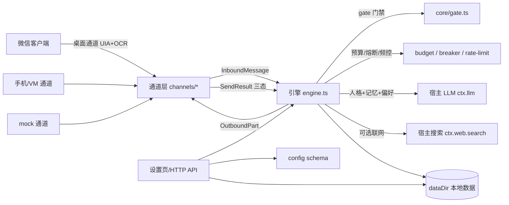

# dsh-wechat-persona

把**你自己的微信小号**变成有「人格」的 AI 聊天分身：被动回复白名单好友、拟人节奏、表情包、按需联网搜索，
并带严格的 token 预算、风控熔断与防误发保护。

> **版本**：3.0.0（开发中，未公开发布）　**上一个已发布版本**：v0.2.8
> **仓库属性**：`private: true`，**不公开发布**，也不发布到 npm。仅供本机/受控环境自用。
> 公开使用前请先读 [DISCLAIMER.md](DISCLAIMER.md)：自动化操作微信客户端违反微信协议，封号风险由使用者自担。

---

## 1. 简介

DSH（DeepSeek Harness）插件。它不接管你的主号，只针对**小号**做「被动回复」：

- 你在设置页配置白名单好友、在线时段、语速与预算；
- 好友给小号发消息 → 插件按门禁规则判断要不要回 → 调用 DSH 宿主已配置的 LLM 生成回复 →
  经所选通道发送；全程本地审计，可随时暂停。

设计取向是**宁可少回、不可发错**：任何无法确认聊天定位、无法确认发送结果、触发风控的场合都选择拒绝或暂停，
而不是猜。

## 2. 功能

| 能力 | 说明 |
| --- | --- |
| 多人格 | 4 个内置人格（小号 / 大肥鱼 / 老周 / 阿码），支持导入自定义人格包（JSON、SillyTavern 卡映射） |
| 被动回复 | 只回复白名单单聊；群聊默认关闭；`whitelistOnly` 默认开 |
| 拟人节奏 | 「正在输入」延时、按概率拆成多条、表情包不连续重复 |
| 按需联网 | 命中天气/新闻/价格等意图才搜索，失败自动降级为不搜 |
| 预算与草稿 | 日 token 预算；超过草稿线只生成不发送；超过预算硬停 |
| 风控熔断 | 验证码/异常登录/限制提示 → 熔断 + 暂停 + 通知；聊天内 `/stop` 紧急停 |
| 防误发 | 桌面通道发消息必须拿到会话行坐标，无坐标直接拒发；投递结果三态，`unknown` 不重试 |
| 记忆 | 每联系人最近消息 + 长期摘要 + 偏好（称呼/忌讳/话题），文件按 contactId 哈希命名 |
| 设置页 | Web 设置页 10 个标签页；所有改动写入宿主 profile 配置，重启不丢 |
| 运维工具 | 6 个 `wechat_persona_*` 工具：status / pause / resume / send_test / clear_memory / clear_audit |
| 安全运行模式 | `safeMode` 开启后，所有真实通道的发送在门禁层被拒绝（仅 mock 空转）；默认关闭，首次配置向导默认建议开启 |
| 诊断与向导 | 设置页首次配置向导、mock 测试入口；`GET /diagnostics/ocr` 只读返回桌面通道最近一次 OCR 读取状态（不截图、不含正文） |
| 4 通道 | mock（默认空转）、phone-adb、windows-vm、desktop（PC 微信 UIA + OCR，默认关闭） |

**v3.0.0 的安全默认值**：默认通道是 `mock`（不碰真实微信）、`channels.desktop.enabled` 默认 `false`、
白名单为空时不回复任何人、聊天内 `/stop` 与 6 个运维工具随时可停。**安全运行模式（`safeMode`，默认 `false`）**
开启后，引擎统一门禁会拒绝向非 mock 通道发送（拒绝原因 `safe-mode`），设置页「预算与安全」可切换；
**只读 OCR 诊断** `GET /diagnostics/ocr` 只返回帧号、引擎、行数与「无法判定」行数等元数据，不触发截图、
不含聊天正文、不落盘；设置页还提供首次配置向导（完成后写 `onboardingDone`）与 mock 测试入口。
以上能力均有单测，真实微信环境尚未端到端验证。详见 [docs/ARCHITECTURE.md](docs/ARCHITECTURE.md)。

## 3. 边界与不做什么

明确**不做**的事：

- ❌ 不接管你的**主号**、不代登录、不扫码、不碰账号态；只面向小号。
- ❌ 不提供群控、营销、批量加好友、自动通过好友、朋友圈操作。
- ❌ 不读微信本地聊天数据库，不注入进程；桌面通道只做「窗口截图 + OCR + UI 自动化」。
- ❌ 不绕过腾讯风控；检测到验证码/异常登录会直接熔断并通知你人工处理。
- ❌ 不做「保证不被封号」的承诺；是否使用、用到什么程度由你决定。
- ❌ 不向外发遥测；除「回复所需内容发给用户自己配置的 LLM 服务商」外，数据留在本机。
- ❌ 不公开分发。本仓库 `private: true`，禁止转售、禁止打包成对外产品。

已知限制：仅 Windows（桌面通道）；OCR 形近字仍是弱项；桌面通道暂不支持发送表情/图片/语音；
真实微信环境需要用户单独授权后才能做端到端验证（见 [docs/TEST-PLAN.md](docs/TEST-PLAN.md)）。

## 4. 架构概览



更完整的分层、时序与数据布局见 [docs/ARCHITECTURE.md](docs/ARCHITECTURE.md)（含 Mermaid 图）；
各通道细节见 [docs/CHANNELS.md](docs/CHANNELS.md)；安装使用细则见 [docs/使用说明.md](docs/使用说明.md)。

## 5. 安装

前置条件：

- DSH 桌面版（含 Web 服务与设置页），插件目标为 DSH 0.2.x；
- Node.js **≥ 22**；
- 仅桌面通道需要：Windows 10/11、Windows PowerShell 5.1、微信 PC 4.x、系统「中文（简体）」OCR 语言包、
  分辨率 ≥ 1366×768；
- 仅第二 OCR 引擎需要（可选）：Python 3 + `rapidocr_onnxruntime`。

方式 A（链接进 profile，推荐）：

```powershell
# 1) 拉取并构建插件（不要把 node_modules 提交回仓库）
npm install --ignore-scripts --no-audit --no-fund
npm run build

# 2) 在 DSH profile 的 package.json 里加依赖（<插件目录> 换成实际路径）
#    "dependencies": { "dsh-wechat-persona": "link:<插件目录>" }

# 3) 在 profile 的 dsh.profile.bundles 里加入 "dsh-wechat-persona"

# 4) 重启 DSH 桌面端
```

方式 B（插件管理器）：调用宿主 `plugin_manager` 的 `action=install_bundle`、`target=<插件目录>`。

安装后：设置 → 「微信分身」，或 Plugins 卡片进入；默认 mock 通道，不会操作真实微信。

## 6. 快速开始（mock，不碰真实微信）

1. 打开设置页，保持 `activeChannel = mock`、`enabled = true`。
2. 在白名单里加一个**虚构**联系人，例如 `{ "id": "contact-a", "name": "好友 A" }`。
3. 保存配置，确认概览页显示通道 `mock`、状态 `running`。
4. 注入一条测试入站消息（本机 HTTP，必须带鉴权头）：

```powershell
$body = '{"text":"在吗？","contactId":"contact-a"}'
Invoke-RestMethod -Method Post `
  -Uri "http://127.0.0.1:<DSH端口>/dsh-wechat-persona/api/test/inbound" `
  -Headers @{ "x-dsh-wechat-persona" = "1" } `
  -ContentType "application/json; charset=utf-8" `
  -Body ([Text.Encoding]::UTF8.GetBytes($body))
```

5. 在「日志与测试」页看审计事件；或 GET `/status`（同样带鉴权头）确认 `delivery` 计数、
   预算与暂停状态。mock 通道的入站/出站记录写入数据目录的 `outbox.jsonl` 与 `audit.jsonl`。
6. 想彻底停掉：设置页关闭插件，或调用 `wechat_persona_pause`。

离线自检（不依赖 DSH 进程、不联网、不碰微信）：

```powershell
node scripts/verify-api.mjs        # 假宿主 + 真实 dist 代码 + 真实 HTTP 端口，PASS/FAIL
powershell -ExecutionPolicy Bypass -File scripts/pwsh/selfcheck.ps1   # Windows/DSH/OCR 环境自检
```

## 7. 配置

配置保存在宿主 profile（`cordis.patch.yml`）中，改完即时生效；字段定义的唯一事实来源是
[`src/config.ts`](src/config.ts)（含默认值与说明）。主要分组：

| 分组 | 关键字段（默认值） | 说明 |
| --- | --- | --- |
| 基础 | `enabled=true`、`activeChannel='mock'`、`dataDir=''`、`ownerName='主人'` | `dataDir` 留空 = 默认工作区下 `.dsh-wechat-persona/` |
| 白名单 | `whitelist=[]`、`whitelistOnly=true` | 为空不回复任何人；每项 `{id,name,aliases,note}` |
| 人格 | `persona.activeId='builtin-small'`、`persona.enabled=true`、`persona.dir=''` | 自定义人格放数据目录 `personas/` |
| 在线时段 | `schedule.onlineStart='08:30'`、`onlineEnd='23:00'`、`pauseOutsideHours=true`、`lowActivityWeekday=1` | 支持工作日/周末单独时段与低活跃日 |
| 频控 | `rateLimit.perContactPerHour=10`、`perContactPerDay=60`、`minReplyIntervalSec=30`、`lowActivityDailyLimit=5` | 命中即 skip，不进模型 |
| 回复 | `reply.maxChars=60`、`maxTokens=160`、`splitProbability=0.35`、`maxSplitParts=2`、`stickerProbability=0.25`、`typingMinMs=800`/`typingMaxMs=5000`、`groupChatEnabled=false`、`privateChatEnabled=true` | 拟人与拆分策略 |
| 表情 | `stickers.enabled=true`、`maxPerReply=1`、`stickerNoRepeatCount=8` | 桌面通道不发表情（能力降级） |
| 记忆 | `memory.recentKeep=30`、`contextMessages=10`、`summaryEveryTurns=50`、`autoSummary=true`、`maxSummaryChars=400` | 长期摘要受预算与每日摘要次数上限约束 |
| 预算 | `budget.dailyTokens=50000`、`draftModeRatio=0.85`、`maxSummaryCallsPerDay=4` | 0.85 线后只生成草稿；用尽硬停 |
| 搜索 | `search.enabled=true`、`maxPerDay=20`、`maxResults=3`、`extraKeywords=[]` | 按需触发，失败降级 |
| 安全 | `safety.forbiddenKeywords`、`pauseOnForbiddenInbound=true`、`blockTransfers=true`、`blockSuspiciousLinks=true`、`circuitBreakerEnabled=true` | 默认命中禁止词即暂停 |
| 安全模式/鉴权 | `safeMode=false`、`onboardingDone=false`、`apiToken=''` | `safeMode=true` 时拒绝向真实通道发送；`apiToken` 留空=兼容模式（回环+请求头），显式配置后强制 Bearer（见 [docs/SECURITY.md](docs/SECURITY.md)） |
| 人格广场 | `market.indexUrl=''`、`market.builtinOnly=false` | 留空只用内置人格，不访问网络 |
| 通道 | `channels.desktop{enabled=false,windowTitle='微信',userActivityIdleMs=5000,pauseSeconds=30,driverEnabled=false}`；`channels.phoneAdb`/`channels.windowsVm`/`channels.mock` | 桌面通道默认关闭且默认只读 |
| 日志 | `logging.auditEnabled=true`、`maxAuditMb=10`、`recentLimit=50`、`level='info'` | 审计可一键清空 |

## 8. 隐私与安全

- **数据默认在本机**：`state.json`、`memory/`、`audit.jsonl`、`drafts.jsonl`、`alerts.jsonl`、
  `deferred-inbound.json`、`desktop-ack.json`（桌面通道 ack 水位线，含联系人名称）、`stickers/`、`personas/`，
  以及可选 `api-token` 文件，都在 `dataDir` 下。
- **会离开本机的只有回复所需内容**：发给**你自己配置的** LLM 服务商的 system prompt（人格定义）与上下文
  （最近对话、长期摘要、联系人偏好、搜索结果）。没有遥测、没有广告 SDK、没有远程日志。
- **截图与日志**：桌面通道截图写系统临时目录并在 OCR 后删除；调试日志默认写
  `%TEMP%\wxuia-engine-debug.log`，**含 OCR 识别到的聊天文本片段**，排障后建议删除。
  可用 `WXUIA_SHOT_DIR` 保留截图副本（默认关，排障/校准用）。
- **剪贴板**：桌面通道发送时临时借用剪贴板粘贴文本，随后恢复原内容（不落盘）。
- **安全运行模式**：`safeMode=true` 时所有非 mock 通道的发送在门禁层被拒，只允许 mock 空转；
  首次配置向导会建议开启。只读 OCR 诊断 `GET /diagnostics/ocr` 不截图、不含正文、不落盘。
- **发送侧防误发**：桌面通道必须拿到会话列表行坐标并通过标题校验；`unknown` 投递不重试；
  暂停/熔断/预算耗尽时不启动新发送。
- 完整数据流与残余风险：见 [docs/PRIVACY.md](docs/PRIVACY.md) 与 [docs/SECURITY.md](docs/SECURITY.md)。
- 提交代码前必须通过敏感数据扫描（0 命中）：

```powershell
node scripts/check-sensitive.mjs
```

## 9. OCR 说明

桌面通道靠「截图 + OCR」读消息，Windows 自带 WinRT OCR 是主引擎：

- **主引擎**：`scripts/pwsh/ocr-winrt.ps1`（Windows OCR，zh-Hans-CN），只读传入的 PNG，不启动微信、不截图；
- **第二引擎（可选）**：RapidOCR（`scripts/py/rapid_ocr.py`），脚本按需调用做双引擎投票；
  需要 Python 3 + `rapidocr_onnxruntime`，缺失时退化为单引擎；
- **纯逻辑层**：`src/core/ocr/` 把归一化、几何、纠错、投票、气泡归属、基线水位线做成纯函数，
  便于离线测试；桌面通道负责截图/调用脚本/投递；
- **保守纠错**：只对同长度、至多差一字的高频词做替换；wxid/手机号/金额/日期/邮箱/URL/订单号/验证码等
  敏感区段一律不纠；跨帧重放依靠 `captureId` + `ack` 水位线 + 稳定 id 去重；
- **已知弱项**：形近字、长消息截断、极小窗口/遮挡、表情与图片内容（本版本不支持表情消息）。

真实基准数字见 [docs/OCR-BENCHMARK.md](docs/OCR-BENCHMARK.md)，设计见 [docs/OCR-DESIGN.md](docs/OCR-DESIGN.md)。

## 10. 测试与基准

常用命令：

```powershell
npm run typecheck        # tsc --noEmit
npm run test:sandbox     # 沙箱单测（推荐；受限环境也兼容）
npm test                 # 普通 vitest
npm run build            # tsc → dist/
npm run verify:api       # 离线 API 验收（假宿主，不联网）
node scripts/check-sensitive.mjs   # 敏感数据扫描，0 命中才算过
```

- 单元测试覆盖：本地 0-token 规则、白名单/时段/频控、预算草稿与硬停、熔断、拆条与表情、
  OCR 纯函数（归一化/纠错/投票/气泡归属/基线水位线）、桌面通道发送三态与防误发、HTTP API 鉴权矩阵、
  安全运行模式拒发与 OCR 诊断只读、配置迁移、通道能力降级等。
- 当前规模（2026-10-31 实测）：`npm run test:sandbox` → **34 个测试文件 / 548 个用例全部通过**；
  `npm run typecheck` 与 `npm run build` 均 exit 0；`npm run verify:api` → **24/24 通过**。
- 基准语料：`test/fixtures/ocr-corpus/`（20 场景 × 2 变体，全虚构内容），离线 OCR 基准：

```powershell
node scripts/ocr/bench.mjs --engine=winrt --limit=1 --scenario=clear --pipeline=raw
node scripts/ocr/bench.mjs --engine=all --pipeline=all --limit=N   # 全量需要 Python 环境
```

- **基准结论**：v0.2.8 后处理基线为 CER 28.09%、整句准确率 32.95%（40 图全量，详见
  [docs/OCR-BENCHMARK.md](docs/OCR-BENCHMARK.md) §6）。v3.0.0 完整方案的离线等价 A/B（tune/eval
  不重叠，只报 eval）：**CER 21.38%、整句 47.83%**，同集 v0.2.8 为 37.37% / 28.26%，跨口径也满足
  「CER ≤ 28.09% / 整句 ≥ 32.95%」的发布门槛（§6.5）。但该结论限定在**合成语料 + 离线等价**口径，
  第二引擎融合/受控纠错在这套语料上几乎未触发（其独立收益未被证明），绝对数字需扩量并在真实微信
  截图（用户授权后）复测，**不能据此宣称真实环境准确率**。
- CI：`.github/workflows/ci.yml` 在 Windows 跑 `npm ci → typecheck → test:sandbox → check-sensitive → build`
  与离线 OCR 冒烟（WinRT/Pillow 不可用时**显式 marked skip**，不联网、不碰真实微信）。

## 11. 发版

- 本仓库 `private: true`，**不公开发布、不发 npm**；由维护者手动在受控环境更新版本与分发。
- 版本语义：修 bug → patch；行为/配置变更 → minor；破坏兼容 → major。
- 发版前必须逐条通过 [docs/RELEASE-CHECKLIST.md](docs/RELEASE-CHECKLIST.md) 的发布门槛
  （10 条质量门槛 + OCR 准确率专项），并记录证据；**当前 3.0.0 的 10 条门槛全部满足，
  OCR 专项达成（限定「合成语料 + 离线等价」）；唯一未完成项是真实设备验证未获授权，
  因此不得对外宣称「真实微信环境已可靠」**。
- 发版流程：更新 `CHANGELOG.md` 与 `package.json`/`src/index.ts` 版本 → 跑完整验证 →
  打 tag → 在受控环境更新安装。禁止在本机未验证的情况下推送或发布。
- 升级/回滚：见 [docs/MIGRATION-v3.md](docs/MIGRATION-v3.md)（含回滚到 v0.2.8 的步骤）。

## 12. 许可

MIT，见 [LICENSE](LICENSE)。使用前请阅读 [DISCLAIMER.md](DISCLAIMER.md)。

- 本项目与腾讯无关，未获得腾讯授权；
- 自动化操作微信客户端可能违反其服务条款，封号/限制风险由使用者自行承担；
- 仅限本人在自己的小号上、在遵守当地法律的前提下使用；禁止用于诈骗、营销骚扰、操作他人账号或绕过风控。

---

文档导航：[docs/使用说明.md](docs/使用说明.md)（安装使用）· [docs/ARCHITECTURE.md](docs/ARCHITECTURE.md)（架构）·
[docs/PRIVACY.md](docs/PRIVACY.md)（隐私）· [docs/SECURITY.md](docs/SECURITY.md)（安全）·
[docs/TROUBLESHOOTING.md](docs/TROUBLESHOOTING.md)（排障）· [docs/CHANNELS.md](docs/CHANNELS.md)（通道）·
[docs/TEST-PLAN.md](docs/TEST-PLAN.md)（测试计划）· [docs/RELEASE-CHECKLIST.md](docs/RELEASE-CHECKLIST.md)（发布检查）·
[CHANGELOG.md](CHANGELOG.md)（变更记录）· [CONTRIBUTING.md](CONTRIBUTING.md) / [docs/CONTRIBUTING.md](docs/CONTRIBUTING.md)（贡献指南）
