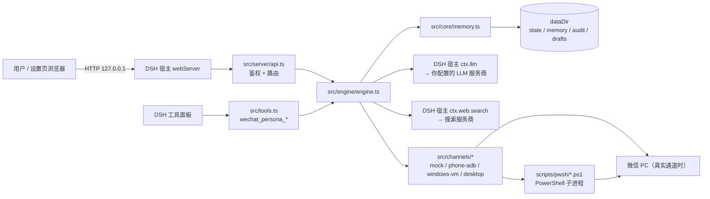
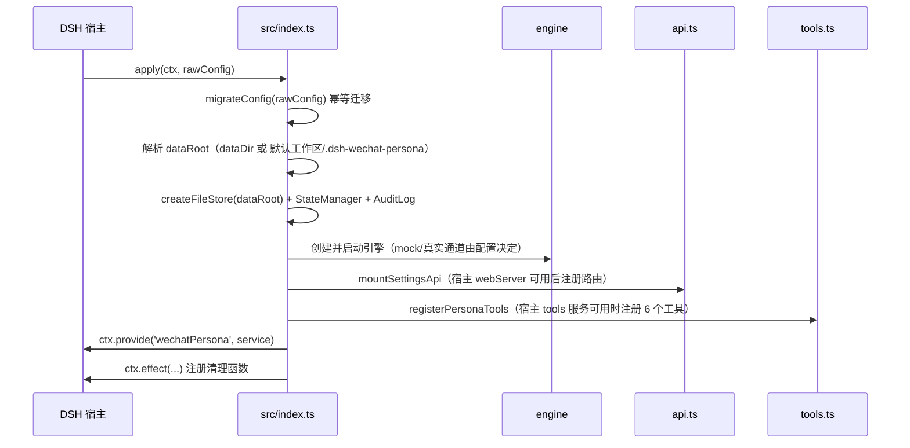
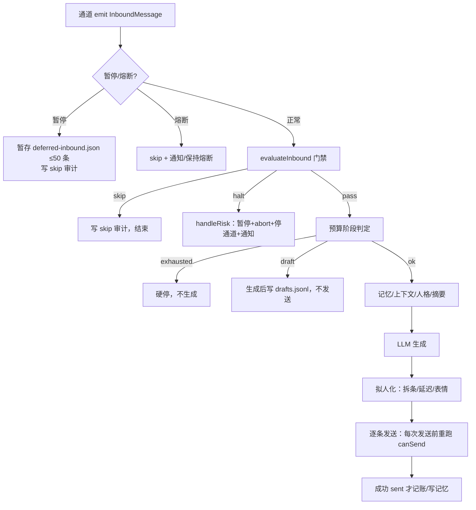
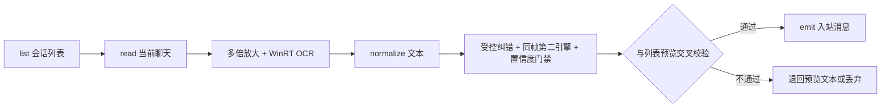

# 架构说明（v3.0.0）

> 适用版本：**3.0.0（开发中，未公开发布）**；上一已发布版本 v0.2.8。
> 本文按当前 `feat/v3.0.0` 分支的真实代码结构编写；文中标注「未验证」的能力表示代码与单测已落地但**真实微信环境尚未验证**，不要按“已在真机生效”理解。
> 相关文档：[使用说明](使用说明.md)｜[通道说明](CHANNELS.md)｜[OCR 设计](OCR-DESIGN.md)｜[OCR 基准](OCR-BENCHMARK.md)｜[安全说明](SECURITY.md)｜[发布门槛](RELEASE-CHECKLIST.md)。

## 1. 定位与约束

dsh-wechat-persona 是 DSH（DeepSeek Harness）的插件：把一个**微信小号**变成有固定人格的 AI 聊天分身，被动回复白名单好友。

硬约束（架构层面的“不可协商项”）：

| 约束 | 含义 |
| --- | --- |
| 只跑在 DSH 宿主内 | 通过宿主提供的 `llm`、`web.search`、`webServer`、`tools`、`configEditor` 等结构化服务工作，不直接读宿主内部文件 |
| 只支持 Windows + 微信 PC | 真实通道（phone-adb / windows-vm / desktop）都是 Windows 上的自动化；mock 通道全平台可用 |
| 默认不碰真实微信 | 默认 `activeChannel: "mock"`、白名单为空、desktop 默认关闭 |
| 数据只在本机 | 无遥测、无自建服务端；外发只有你配置的 LLM、搜索、以及你手动填写的人格广场 URL（见 [PRIVACY.md](PRIVACY.md)） |
| 宁可失败也不发错人 | 定位不确定时返回 `{ok:false}`；发送结果分三态，`unknown` 绝不自动重试 |

## 2. 设计原则

1. **引擎与通道解耦**：引擎只依赖 `Channel` 接口，切换通道不改变人格、记忆与安全逻辑。
2. **纯逻辑可单测**：网关、预算、频控、OCR 文本处理等关键逻辑抽成无副作用纯函数（`src/core/**`），复杂 I/O 留在通道/宿主边界。
3. **失败安全优先**：任何不确定都走“拒绝/降级/暂停”，绝不“猜一个目标继续发”。
4. **结构化输出**：脚本与插件之间只传单行 JSON；通道发送结果带投递三态。
5. **可清理可回滚**：所有资源注册在 `ctx.effect`；状态文件可归一化/回退默认；不提交 `dist/`。

## 3. 系统上下文



数据外发边界只有三处：LLM 服务商（对话内容）、搜索服务商（查询词）、人格广场 URL（手动配置时）。截图/OCR 图像不上传。

## 4. 运行时装配（`src/index.ts`）

插件入口不 import 宿主包类型，只用结构化接口（`Plugin`/`Context` 形状自声明），避免宿主版本耦合。



要点：
- 数据目录在 boot 时解析：`dataDir` 留空 → 宿主默认工作区下 `.dsh-wechat-persona/`；失败回退进程工作目录。
- 设置页 API 依赖宿主的 `webServer`/`library`/`stickersCatalog`/`memoryStore`；boot 结束时试挂一次，并在 `ctx.inject(['webServer'])` 后补挂一次。挂载失败写 `%TEMP%\dsh-wechat-persona-debug.log`（只含启动诊断，不含聊天正文）。
- 引擎、审计、Api 路由都用 `ctx.effect` 注册 dispose，插件停用/重载时清理定时器与监听。
- 配置保存走宿主 `configEditor.edit` 写入 profile 的 `cordis.patch.yml`；宿主无 configEditor 时设置页只读。

## 5. 模块地图

```
src/
├─ index.ts            插件入口/装配/设置页 API 挂载/工具注册
├─ config.ts           schemastery 配置 schema + 默认值 + migrateConfig
├─ types.ts            全部对外/对内接口与领域类型（SendDelivery、Channel、EngineStatus…）
├─ tools.ts            6 个 wechat_persona_* 运维工具
├─ server/api.ts       设置页 HTTP API（鉴权、路由、参数校验、限流）
├─ engine/
│  ├─ engine.ts        引擎：门禁→预算→上下文→LLM→拟人化→发送→记账
│  └─ summarizer.ts    长期摘要（按轮数/预算触发）
├─ channels/
│  ├─ channel.ts       按 activeChannel 装配通道
│  ├─ mock.ts          空转通道：读写本地 JSON，不碰微信
│  ├─ phone-adb.ts     Android 通知监听 + adb 输入
│  ├─ windows-vm.ts    TCP 桥到独立 VM/会话里的 agent
│  ├─ risk.ts          风控文案识别（验证码/异常登录/限制登录…）
│  └─ pc/desktop.ts    本机桌面自动化（截图 + WinRT OCR + 坐标操作）
├─ core/
│  ├─ gate.ts          入站门禁（白名单/去重/时段/频控/禁用词…）
│  ├─ budget.ts        每日 token 预算三阶段（ok/draft/exhausted）
│  ├─ breaker.ts       风控熔断（trip/reset + 持久化）
│  ├─ rate-limit.ts    每联系人时/日/间隔限制 + 低活跃日
│  ├─ schedule.ts      在线时段/低活跃日/下次在线时间
│  ├─ humanize.ts      拟人化：拆条、输入中延迟、表情概率
│  ├─ emotion.ts       入站情绪分类（选表情包用）
│  ├─ memory.ts        每联系人记忆（最近消息/摘要/偏好）
│  ├─ preferences.ts   偏好抽取/合并/格式化
│  ├─ stickers.ts      表情目录扫描与选择（去连续重复）
│  ├─ persona.ts       旧版 persona.md/examples.md 加载
│  ├─ persona-library.ts 多套人格库（安装/导入/导出/映射角色卡）
│  ├─ persona-market.ts 人格广场（远程索引，可选）
│  ├─ search-intent.ts 是否需要联网搜索 + 生成查询词
│  ├─ stop.ts          聊天内 /stop 识别与暂停/恢复辅助
│  ├─ state.ts         运行状态持久化（逐字段归一、串行写）
│  ├─ audit.ts         审计 JSONL（滚动/汇总/清空）
│  ├─ notifier.ts      通知（alerts.jsonl + 宿主通知）
│  ├─ send-state.ts    **v3.0.0 新增**：10 态发送状态机（纯函数 + 合法转换表）
│  ├─ send-ledger.ts   **v3.0.0 新增**：sendOperationId 幂等账本（dataDir/send-ledger.json）
│  └─ ocr/             OCR 纯逻辑层（v3.0.0 新增，见 §8）：types/geometry/normalize/correction/vote
│                       + fusion/align/confidence/tracker/baseline/bubbles/pipeline
├─ llm/
│  ├─ client.ts        包装宿主 ctx.llm 流式接口（usage 统计）
│  ├─ prompt.ts        构造系统提示词与对话上下文
│  └─ search.ts        包装宿主 ctx.web.search
├─ util/               fs-store / host / logger / misc / time
└─ client/client.js    设置页前端（纯 JS，无需构建）
```

## 6. 通道层

```ts
interface Channel {
  readonly id: ChannelId
  start(handler: InboundHandler, onRisk: RiskHandler): Promise<void>
  stop(): Promise<void>                         // 幂等
  send(contactId: string, part: OutboundPart, signal?: AbortSignal): Promise<SendResult>
  status(): ChannelStatus
  readonly capabilities?: ChannelCapabilities   // stickers/images/voice
  scanRisk?(): Promise<RiskSignal[]>
}
```

| 通道 | 原理 | 默认 | 能力 | 关键限制 |
| --- | --- | --- | --- | --- |
| `mock` | 入站从本地文件/测试注入，出站写 `outbox.jsonl` | ✅ 默认 | 文本 | 不接触微信，适合验收全流程 |
| `phone-adb` | 监听 Android 微信通知 + adb 输入 | 关闭 | 文本（表情需坐标配置） | 需要 USB/无线调试、坐标校准 |
| `windows-vm` | 插件 ↔ VM 内 agent 的 TCP 桥 | 关闭 | 文本/表情（由 agent 决定） | 需要在独立 VM/会话部署 agent |
| `desktop` | 只截微信窗口 → WinRT OCR → 点击/键入 | 关闭（风险最高） | 文本 | 无表情；依赖 OCR 与窗口几何；真实环境未充分验证 |

通道状态机：`stopped → starting → running → degraded / error`；连续失败 6 次进入停摆（`MAX_CONSECUTIVE_FAILURES=6`），需重载插件恢复。风控信号（验证码/异常登录/限制登录）由通道上报或在桌面通道轮询截图时识别，交给引擎熔断。

**桌面通道（`src/channels/pc/desktop.ts`，v3.0.0 强类型化）**：
- 轮询列表（约 2s）→ 会话行预览 → 对候选先 `read` 校验完整性与防串聊 → 同一帧 WinRT OCR +（按需）第二引擎 → 几何/序列融合与置信度门禁 → 去重后 `emit`。
- 发送：必须从最近一次列表拿到该联系人的**行坐标**；没有行坐标直接拒绝（不再用“最近活跃会话”兜底）。发送前检查用户键鼠空闲（`user-activity.ps1`），忙则让路；向脚本传 `-RowTop/-RowLeft/-RowHeight`，**不传 `-CurrentContact`**，避免脚本走“标题可信直开”分支造成跨联系人误发。
- 发送幂等：引擎在 `canSend` 之后、`channel.send` 之前查 `send-ledger.json`；同一 `sendOperationId` + `partIndex` 只执行一次；`unknown` 永远不会被自动重放（详见 §7）。
- 脚本契约：stdout 单行 JSON；`send` 成功 `{ok:true}`，不确定时 `{ok:false,error,delivery:'unknown'}`。脚本内部不再自动重试不确定的发送。

## 7. 引擎：一次入站消息的处理



**入站门禁顺序**（`src/core/gate.ts` 的 `evaluateInbound`）：
disabled → breaker → paused（只 skip 不 halt）→ group-chat → self-message → not-whitelisted → empty-message → noise（纯标点）→ pure-sticker → duplicate（`contactId:msgId` 指纹，6h TTL）→ offline-hours → 低活跃日/频控 → forbidden-content（默认 halt 并暂停，可配置只记录）。通过后记录指纹。

**统一发送门禁** `engine.canSend()`：AbortSignal 已中止 → `paused`；`state.paused` → `paused`；`breaker.tripped` → `breaker`；安全运行模式且非 mock 通道 → `safe-mode`；预算 `exhausted` → `budget-hard-stop`；白名单不匹配 → `not-whitelisted`；频控 → 对应 reason。手动发送（`send_test`、`/test/send`）走同一门禁，暂停时返回 409；`engine.start()` 传 `checkSafeMode:false`（接收消息是安全的，safeMode 只拦发送）。

**发送循环**：每个 part 发送前、每次重试前都重新跑 `canSend()`；最多 2 次尝试；只有 `delivery === 'not-sent'` 才重试；`unknown` 一律不重试；任一部分失败即中止本批（避免半截刷屏）。成功写 `send` 审计，失败写 `send-fail`，`/status` 暴露 `delivery: {sent, notSent, unknown}`。

**发送状态机与幂等账本（v3.0.0）**：`src/core/send-state.ts` 定义 10 态（`received → validated → generating → draft/ready → sending → confirmed/failed/unknown/cancelled`）与合法转换表；`failed` 只有在账本证明 `not-sent` 且尝试次数未超限时才可回到 `ready`。`src/core/send-ledger.ts` 以 `sendOperationId` + `partIndex` 为键记录 `{state, attempts, delivery, textHash}`（**只存文本哈希，不存正文**，上限 200 条，持久化到 `dataDir/send-ledger.json`）；终态 `confirmed/unknown/cancelled` 不再发送，`unknown` 绝不自动重放。引擎在 `canSend` 通过后、`channel.send` 之前查账本，多段拆条逐段记账；重启后加载账本，避免 DSH 重试/子进程异常导致重复发送。

**发送模式（`sendMode`）与安全运行模式**：`sendMode` 取 `auto`（默认，生成后自动发送）/ `draft` / `confirm`（后两者只生成草稿，写入 `dataDir/drafts.json`，上限 50 条、24 小时 TTL，需在设置页或 `POST /drafts/approve` 人工批准）。批准时会**重走完整 `canSend` 门禁**并复用同一 `opId`，因此暂停/白名单/预算不通过时会被拒绝。优先级：预算草稿/超限 > `safeMode` > `sendMode`；`safeMode=true` 时任何非 mock 通道都只生成草稿，不可能自动发出去。

**暂停/恢复**：暂停会 abort 在飞请求并停通道；暂停期间入站消息暂存 `deferred-inbound.json`（最多 50 条），恢复后按序补处理（中途再次暂停则剩余保留）。恢复会清熔断、重建 `AbortController`、重启通道并 flush 积压。聊天内 `/stop` 可暂停（仅白名单）；`/resume` 相关函数已定义但**尚未接入引擎**，恢复请用工具或 `POST /resume`。

**预算**：`budgetPhase` 三态；`spent >= dailyTokens * draftModeRatio(0.85)` 进入草稿模式（只生成不发，写 `drafts.jsonl`）；`spent >= dailyTokens` 硬停。预算不阻止 `engine.start()`（否则重启后通道永远起不来）。

**风控熔断**：`handleRisk` 在 `safety.circuitBreakerEnabled=true`（默认）时 `tripBreaker` + 暂停 + abort + 停通道 + critical 通知 + 持久化；关闭时只记录和通知。

## 8. OCR 子系统

### 8.1 v3.0.0 分层

v0.2.8 把 OCR 文本处理都写在 `desktop.ts` 里（带 `@ts-nocheck`）。v3.0.0 抽出纯逻辑模块并强类型化：

| 文件 | 职责 |
| --- | --- |
| `src/core/ocr/types.ts` | OCR 领域类型：`OcrBox/FrameMeta/OcrLine/OcrResult`、`BubbleSide`、`BubbleOwnership/BubblePane`、`SendDelivery/SendResult`、`OcrEngine` 接口 |
| `src/core/ocr/geometry.ts` | 纯几何：`iou`、`intersectionBox`、`unionBox`、`groupLinesIntoRows`、`toLogicalBox/fromLogicalBox`（跨帧坐标必须换算） |
| `src/core/ocr/normalize.ts` | 文本归一：展示用 `normalizeOcrText`（去 CJK 字间空格等）、比较用 `compareKey`（去空白标点/全角转半角/小写）；相似度与 CER |
| `src/core/ocr/correction.ts` | 质量评估 `noiseScore/looksGarbled/pickBetterText` + 受控纠错（同长度、至多差一字、敏感区段跳过） |
| `src/core/ocr/vote.ts` | 旧双引擎投票 `mergeEngineVote`（重合度 <0.35 信任系统 OCR）；作为 A/B 基线与预览回退路径保留，生产桌面通道的分层决策见 §8.2 |
| `src/core/ocr/fusion.ts` | **v3.0.0 新增**：双引擎几何匹配 `matchLines`（IoU/中心距/垂直重合/水平相邻/同气泡，一对一贪心；**只看几何、不比文本长度**） |
| `src/core/ocr/align.ts` | **v3.0.0 新增**：顺序保持的 Levenshtein 序列对齐（跨气泡禁止替换，避免“强行配对”） |
| `src/core/ocr/confidence.ts` | **v3.0.0 新增**：可解释置信度 `evaluateConfidence`（原生 confidence/清晰度/多引擎一致性/框匹配/截断与纠错/联系人验证），输出 `accept/verify/reject` |
| `src/core/ocr/tracker.ts` | **v3.0.0 新增**：跨帧稳定身份与 LCS 差分 `classifyFrameDelta`（replay/ocr-changed/insert/scroll/duplicate/reset） |
| `src/core/ocr/baseline.ts` | **Phase C 新增**：基线尾对齐、pending 队列、captureId/ack 水位线、稳定消息 id |
| `src/core/ocr/bubbles.ts` | **Phase C 新增**：按聊天面板几何做气泡归属（inbound/outbound/uncertain），不确定不投递 |
| `src/core/ocr/pipeline.ts` | **Phase C 新增**：把一次 read 输出变成“可投递消息”的决策（过滤/去重/兼容旧脚本输出） |

> 接入状态（诚实说明）：`baseline/bubbles/pipeline` 与 `confidence` 已接入 `desktop.ts` 读取路径；`fusion/align/tracker` 已实现并有单测（`test/core/ocr-{fusion,align,tracker}.test.ts`），但**尚未接入生产读取路径**（生产路径的双引擎决策在 `wechat-uia.ps1` 的分层规则与 `desktop.ts` 的置信度门禁/旧投票回退）。它们用于任务书第六部分的离线评估与后续接线，不能按“已在真机生效”理解。

> 状态（Phase C 已实现，真实环境未验证）：`baseline/bubbles/pipeline` 有单测（`test/core/ocr-{baseline,bubbles,pipeline}.test.ts`），`desktop.ts` 与 `scripts/pwsh/wechat-uia.ps1` 已双向接线——read 时脚本输出 `captureId/pane/lines[].side/box/messages[]`，调用方下次读取回传 `-Ack <上次成功投递的 captureId>`，脚本只丢弃 ≤ 水位线的 pending 行并对未确认行重放（id 稳定，TS 侧按 id 去重）；`desktop.ts` 用 `planInboundDispatch` 拒绝 `uncertain/outbound` 并 `commitAck`。旧脚本输出（无这些字段）走 legacy 兼容分支全部接受。**真实微信窗口下的端到端效果仍需用户授权后验证**（见 [RELEASE-CHECKLIST.md](RELEASE-CHECKLIST.md) 门槛 2）。

### 8.1 只读测试模式与 OCR 流水线开关（发布前验收）

- 
eadOnlyTestMode（配置，默认 false）四层阻断真实发送：engine.canSend 返回 
ead-only-mode（自动回复/重试/sendTest/approveDraft 共用）、desktop.send() 首行直接拒绝（不调用脚本）、POST /test/send 与 POST /drafts/approve 返回 409、PS1 -ReadOnly（send 在定位窗口前失败；read 强制 -NoSearch；不恢复/移动/置顶/切前台窗口）。只读模式不阻断 LLM 调用与只读 OCR。
- ocrPipelineMode：3（默认）走 planInboundDispatch + 置信度门禁；legacy 走 planReadLegacy（接受全部非空文本、跳过归属/置信度门禁），用于受控回退；两者共用同一发送安全门禁，不会因切算法放开自动发送。

### 8.2 桌面通道读写路径



- 引擎：Windows 自带 WinRT OCR（`scripts/pwsh/ocr-winrt.ps1`，zh-Hans-CN，只读图片、不启动微信）。截图先按 `WXUIA_UPSCALE`（默认 2 倍）最近邻放大再 OCR；单帧约 70–120ms（见 [OCR-BENCHMARK.md](OCR-BENCHMARK.md)）。
- 同帧约束：一次 read 只拍一帧（`-KeepImage` 保留该 PNG），WinRT 与第二引擎都识别**同一个文件**，不再另拍一帧（`wechat-uia.ps1` 的 `LastSnapshotImage` / `readImage`）；输出所有行共享同一 `captureId`。
- 气泡归属：脚本按聊天面板几何（上方 10% 标题/工具栏、下方 15% 输入框）提取候选行，`Get-BubblePane/Get-BubbleSide` 判 `left/right/unknown`；明确为右侧（自己）的行直接跳过，`unknown`（长气泡越线、两侧都不贴、越出面板）随 `box/pane` 输出，TS 侧 `planInboundDispatch` 拒投并计数。
- 基线不丢：脚本先保存（临时文件 + rename 原子写）再输出；新行进入 pending 队列，输出含本次新行与上次未确认行的重放；ack 水位线只丢弃 ≤ 已确认帧的行；消息 id = `pc-<captureSeq>-<messageSeq>-<几何哈希>`（**不含 OCR 文本**，跨帧稳定；连发两条相同文本因 `messageSeq` 不同仍是两条），TS 侧 `inFlight` 按 id 去重；`desktop.ts` 另将成功投递的 id 持久化到 `dataDir/desktop-delivered.json`（FIFO 500、串行原子写、启动时懒加载），`wasDelivered` = 内存 `inFlight` ∪ 持久化 `deliveredIds`，修复「重启后脚本重放 pending 导致重复投递」。ack 水位线落在 `dataDir/desktop-ack.json`，重启后读回。
- 置信度门禁（v3.0.0）：`desktop.ts` 对每条候选调用 `evaluateConfidence`，`accept` 放行；`verify` 用同一帧再跑一次第二引擎（`-SecondOcr`，不二次截图）后重新评估；仍不可信则 `markRejected` 并**不推进 ack**，脚本 pending 下次重放（绝不永久吞消息）；脚本/引擎都无法给出可解释证据时不臆断，直接不投递。`/diagnostics/ocr` 暴露 reject/uncertain/conflict 等计数。
- 双引擎分层决策：`wechat-uia.ps1` 的 `-SecondOcr` 只对同一帧的第二引擎结果做几何匹配：重叠 ≥0.90 判 `agree`（取第二引擎分数为 confidence）；0.35–0.90 判 `conflict`（`conflictCount++`），仅当第二引擎分数 ≥0.85 才替换文本；无匹配判 `single`。**不再使用“谁更长谁赢”**；`vote.ts` 的旧规则只用于 A/B 基线与回退路径。
- 跨帧差分（`tracker.ts`）：已实现加权 LCS（replay/ocr-changed/insert/scroll/duplicate/reset 分类）并有单测，**尚未接入生产读取路径**；当前生产去重依赖脚本稳定 id + TS `inFlight` 集合。
- 纠错边界：只做“同长度、至多差一个高频词”的替换，且跳过 wxid/手机号/金额/日期/邮箱/URL/订单号/验证码/密码/身份证等敏感区段，变更明细写审计。
- 第二引擎可用性：RapidOCR（Python）是**可选**第二引擎，脚本调用 `scripts/py/rapid_ocr.py` 识别同一帧截图；Python 或依赖缺失时静默回退单引擎，不是必需依赖（CI 冒烟也只要求 WinRT）。
- 表情/图片/语音：桌面通道 `capabilities` 为 false，不发送表情（设置页会降级）。

### 8.3 脚本契约

- `scripts/pwsh/wechat-uia.ps1`：`-Action send|read|list|shot`，stdout 只输出一行 JSON；`send` 成功 `{ok:true}`；失败 `{ok:false,error}`；不确定投递时带 `delivery:'unknown'`。`read` 接受 `-Ack <captureId>`（确认水位线）与 `-SecondOcr`（同帧第二引擎），输出 `{ok,captureId,engines,pane,lines[],messages[],diag?}`；`lines[]` 含 `text/side/captureId/box/merged/confidence/agreement`；`messages[]` 含 `id/text/captureId/seq/side/box/receivedAt`，本次新行与 pending 重放行混排、id 稳定（`pc-<captureSeq>-<messageSeq>-<几何哈希>`）；`diag` 只含 `scale/screenshotMode/engineVersion/conflictCount/secondOcrUsed/qualityStatus/dpi`（不含正文）。只截微信窗口区域、不读剪贴板内容（发送时临时借用剪贴板粘贴中文并恢复）、不联网。
- 调试：`WXUIA_DEBUG`/`WXUIA_SHOT_DIR` 等环境变量可控（见 [CHANNELS.md](CHANNELS.md)）；默认日志 `%TEMP%\wxuia-engine-debug.log` 含 OCR 行文本，敏感环境请自行清理。
- `scripts/pwsh/ocr-winrt.ps1`：`-Path <png> [-Language zh-Hans-CN]`，输出单行 JSON（含 lines/elapsedMs/width/height），失败 exit 1。
- `scripts/ocr/bench.mjs`：离线基准 CLI（只读 `test/fixtures/ocr-corpus` 合成图，不截图、不启动微信、不发送）。

## 9. LLM、搜索、人格、记忆与通知

- **LLM**（`src/llm/client.ts`）：包装宿主 `ctx.llm` 流式接口；默认跟随 DSH 当前默认模型，兜底 `deepseek-account / deepseek-flash`；统计 token 与缓存读 token，写入状态与审计。
- **提示词**（`src/llm/prompt.ts`）：系统提示词 = 人格（名字/风格/系统设定/口头禅/示例/禁忌） + 插件规则；上下文 = 最近对话（`memory.contextMessages`） + 长期摘要 + 联系人偏好记忆 + 当次搜索结果。
- **搜索**（`src/llm/search.ts`）：包装宿主 `ctx.web.search`；由 `search-intent.ts` 判断是否需要搜；失败降级（不阻塞回复）。
- **人格库**（`core/persona-library.ts`）：内置 4 套人格 + 导入/安装/导出；支持映射 SillyTavern 角色卡；非法 id 与路径做校验。
- **人格广场**（`core/persona-market.ts`）：仅在 `market.indexUrl` 非空时工作，默认只用内置人格。
- **记忆**（`core/memory.ts`）：每联系人一个 JSON（文件名为 `sha1(contactId)` 前 16 位），存最近消息、长期摘要、偏好、最近表情 id；所有读写串行。
- **表情**（`core/stickers.ts`）：扫描贴纸目录、防止连续重复；按通道能力降级。
- **通知**（`core/notifier.ts`）：写 `alerts.jsonl` 并调用宿主通知；含熔断/预算/自检等事件。

## 10. 数据与持久化

```
<dataDir>/
├─ state.json              运行状态（暂停/熔断/预算/频控/去重指纹/统计）
├─ memory/<hash>.json      每联系人记忆
├─ audit.jsonl             审计（滚动到 audit.1.jsonl）
├─ alerts.jsonl            通知记录
├─ drafts.jsonl            预算草稿（历史追加格式，兼容）
├─ drafts.json             发送模式草稿队列（正文、上限 50 条、24h TTL；批准后才发送）
├─ send-ledger.json        发送幂等账本（sendOperationId/partIndex → state/attempts/textHash；只存文本哈希；≤200 条）
├─ deferred-inbound.json   暂停期间积压的入站消息（≤50）
├─ outbox.jsonl            mock 通道输出
├─ api-token               API 运维参考 token（0600，非强制）
├─ desktop-ack.json        桌面通道 ack 水位线（每联系人最近已确认的 captureId，跨进程重启读回）
├─ desktop-delivered.json  桌面通道已投递消息 id 去重表（FIFO 500，跨进程重启不重放）
├─ stickers/               上传的表情
└─ personas/               自定义人格包
```

- `FileStoreLike` 是注入的文件抽象（相对 dataDir），单测用内存 store；写入串行，失败只 warn 不阻塞主流程。
- `desktop-delivered.json` 记录已成功投递的消息 id（每联系人 FIFO 500 条），懒加载并在每次投递成功后串行落盘；删除它会让重启后可能重复投递一次，已投递判定的第一道仍是内存 `inFlight`。
- `desktop-ack.json` 由桌面通道懒加载（首次 read 前）并在每次 `commitAck` 后串行落盘；写失败只记 debug，不阻塞读取。删除它只会让下一次 read 从 0 水位线开始（脚本按稳定 id 去重，不会重复投递已处理消息）。
- `drafts.json` 保存 `draft/confirm/safeMode/预算` 模式下的待发送草稿（含回复正文，24h TTL，上限 50 条）；批准/拒绝后状态流转并复用同一 `opId`。删除等于放弃所有未批准草稿（不会发送）。
- `send-ledger.json` 是幂等账本：键为 `opId` + `partIndex`，记录 `{state, attempts, delivery, textHash}`（**不落正文**），上限 200 条，终态不重发；删除只会让后续发送失去“防重放”记忆（不建议在发送中途删除）。
- `state.json` 读取时**逐字段归一**：缺字段补默认、损坏回退默认并 warn、去重指纹有界（2000 条/6h TTL）。
- 配置不写在 dataDir，而是宿主 profile 的 `cordis.patch.yml`（见 §4）。

## 11. HTTP API 与鉴权

基址：`http://127.0.0.1:<DSH端口>/dsh-wechat-persona/api`。

**鉴权链**（`src/server/api.ts` 的 `checkAuth`，顺序固定）：
1. 来源必须是回环地址（`127.0.0.1` / `::1`），否则 403；
2. 必须带 `x-dsh-wechat-persona: 1`，否则 403；
3. 浏览器请求的 `Host` 必须是回环主机名（防 DNS rebinding）；带 `Origin` 时必须是本机回环来源（防 CSRF）；`Sec-Fetch-Site: cross-site` 直接拒绝；
4. 若配置了 `apiToken`，还必须带 `Authorization: Bearer <token>`（或 `x-dsh-persona-token`），否则 401；
5. 进程内限速：每来源 240 次/分钟，超出 429。

**接口分组**：

| 分组 | 路由 |
| --- | --- |
| 健康/状态 | `GET /health`、`GET /status`（含 `safeMode`/`sendMode`/`sendState`/`pendingDrafts` 与 `security.rateLimitPerMinute`） |
| 诊断 | `GET /diagnostics/ocr`（只读：通道最近一次 OCR 读取的 captureId/引擎/行数/uncertain/reject/conflict/耗时/最后错误/DPI/scale/截图方式/引擎版本/是否二次识别/质量状态；不触发截图、不含聊天正文，字段间有钳制与白名单） |
| 配置 | `GET /config`（隐藏 `apiToken`，返回 `apiTokenConfigured`）、`POST /config`（`{config}`） |
| 草稿 | `GET /drafts`、`POST /drafts/approve`、`POST /drafts/reject`（body `{id}`；404=不存在、409=已处理/门禁拒绝/引擎未启动、400=请求非法；批准重走 `canSend` 并复用同一 `opId`） |
| 人格 | `GET /personas`、`POST /personas/install|import|activate|export` |
| 人格广场 | `GET /market`、`POST /market/install` |
| 表情 | `GET /stickers`、`POST /stickers/upload`、`GET /sticker-file` |
| 日志 | `GET /logs` |
| 自测 | `POST /test/inbound`、`POST /test/send` |
| 运维 | `POST /pause`、`POST /resume`、`POST /memory/clear`、`POST /audit/clear` |
| 帮助 | `GET /help`（读 docs/使用说明.md 与 CHANGELOG.md） |

请求体上限 4MB（贴纸 2MB；导入人格 JSON 2MB；读 body 超时 10s）。所有出口都包在 `try/catch` 里，最差返回 500，不崩宿主。

## 12. 安全边界

1. **不发错人**：桌面发送只认会话列表行坐标 + 标题/内容交叉校验；没有定位信息直接拒绝；发送脚本不再信任“当前会话标题”捷径。
2. **不重复发**：投递三态；`unknown` 不重试；部分失败中止整批。
3. **不越权**：API 仅回环 + 请求头 +（可选）token + Host/Origin 校验；非授权请求不能触发发送。
4. **不读微信数据**：不读聊天数据库、不解密；桌面通道只读屏幕像素。
5. **不静默外发**：LLM/搜索/人格广场三条外发路径在 [PRIVACY.md](PRIVACY.md) 逐项列出；无遥测。
6. **风控优先**：验证码/异常登录/限制登录等信号触发熔断与暂停，需人工确认安全后恢复。
7. **安全运行模式**：`safeMode`（默认 `false`，保持升级兼容）开启后，所有非 mock 通道的发送在门禁层被拒（`safe-mode`），只允许 mock 空转；设置页「预算与安全」可切换，首次配置向导默认建议开启。
8. **远程人格市场 SSRF 缓解**：`market.indexUrl`/`entry.url` 仅允许 `http/https`，拒绝回环/内网/链路本地/`.local` 等主机与内嵌凭据；`redirect: 'manual'` 最多 2 跳且每跳重新校验；响应必须是 JSON、双上限 2MB。**残余面**：DNS rebinding（校验后域名解析到内网）尚未完全消除，详见 [SECURITY.md](SECURITY.md)。

## 13. 测试与验证

| 层级 | 位置 | 说明 |
| --- | --- | --- |
| 单元/集成测试 | `test/**/*.test.ts`（vitest） | core 纯逻辑、通道、引擎验收、server API、client 冒烟；`test:sandbox` 用 `--pool=threads` 适配受限环境 |
| 安全/诊断专项 | `test/server/api.test.ts`、`test/engine/acceptance.test.ts` | 鉴权矩阵、限速、safeMode 拒发（真实通道 0 次 `channel.send`、审计 `safe-mode`、sendTest 返回 `not-sent`）、`GET /diagnostics/ocr` 只读白名单字段与降级、草稿批准/拒绝与幂等 |
| 幂等/发送状态 | `test/core/send-ledger.test.ts`、`send-state.test.ts`、`test/engine/acceptance.test.ts` | 同一 `opId` 只发一次、`unknown` 不重发、重启后账本恢复、草稿批准复用 opId |
| OCR 纯逻辑 | `test/core/ocr-*.test.ts` | fusion 几何匹配、align 序列对齐、confidence 决策、tracker 跨帧分类、baseline/bubbles/pipeline |
| 离线 API 验收 | `scripts/verify-api.mjs` | 假宿主 ctx + 真实 dist + 真 HTTP，不联网、不碰微信 |
| OCR 基准 | `scripts/ocr/bench.mjs` + `test/fixtures/ocr-corpus/` | 合成语料（全虚构），可复现实验，只读样本 |
| 环境自检 | `scripts/pwsh/selfcheck.ps1` | Windows/微信/DSH/OCR/构建/API/数据目录，JSON + 人话结论 |
| CI | `.github/workflows/ci.yml` | Windows：typecheck → 单测 → 集成 → Windows 兼容 → build → API 验收 → 依赖审计 → 敏感扫描 → 发布包检查 → OCR 冒烟；Linux：typecheck/单测/敏感扫描，OCR 冒烟显式 marked skip |

当前测试规模与结果见 [RELEASE-CHECKLIST.md](RELEASE-CHECKLIST.md) 的记录（以真实运行输出为准）。

## 14. 已知限制与未完成

- **仅 Windows + PC 微信**；桌面通道依赖中文 OCR 语言包与窗口几何，窗口极小/遮挡时进入 degraded。
- **OCR 准确率**：v3 管线离线等价 A/B（tune/eval 不重叠，只报 eval 集 46 条消息）CER **21.38%**、整句 **47.83%**，同集 v0.2.8 为 37.37% / 28.26%，跨口径也满足发布门槛（CER ≤ 28.09% / 整句 ≥ 32.95%）；**限定合成语料 + 离线等价口径**，第二引擎融合与受控纠错在该语料几乎未触发，真实微信截图需用户授权后复测。详见 [OCR-BENCHMARK.md](OCR-BENCHMARK.md) §6.5。
- **Phase C**（同帧/基线/captureId/ack/气泡归属）：纯逻辑 + `desktop.ts` + `wechat-uia.ps1` 已双向接线并有单测（ack 水位线、pending 重放、稳定 id、uncertain 拒投）；**真实微信窗口下的端到端效果未验证**，见 [RELEASE-CHECKLIST.md](RELEASE-CHECKLIST.md) 门槛 2。
- **Phase F**（安全运行模式、OCR 诊断、首次配置向导、mock 模拟器）：已实现——`safeMode` 配置（默认 `false`）在门禁层拦截真实通道发送；`GET /diagnostics/ocr` 只读透出通道 OCR 状态（不截图、不含正文）；设置页含首次配置向导（写入 `onboardingDone`）与 mock 测试入口；均有单测，**真实环境未验证**。
- **发送可靠性（状态机/幂等/草稿）**：`send-state`/`send-ledger`/`drafts.json` 已实现并有单测（同一 opId 只发一次、`unknown` 不重发、草稿批准重走门禁）；**真实微信环境（含 DSH 重启、脚本超时、子进程异常）未实机验证**，不能据此宣称“绝不重复发送”。
- **OCR 融合/对齐/跨帧差分**：`fusion.ts`/`align.ts`/`tracker.ts` 已实现并有单测，但**尚未接入生产读取路径**（生产使用脚本分层 SecondOcr + pipeline 几何归属 + confidence 门禁）；任务书第六部分的离线融合收益也未在真实截图上验证。
- **真实微信环境**：桌面通道发送可靠性等需用户单独授权后才能实机验证；未验证项在 [RELEASE-CHECKLIST.md](RELEASE-CHECKLIST.md) 标注。
- 本仓库 `private: true`，不对外发布、不承诺 API 稳定性。
